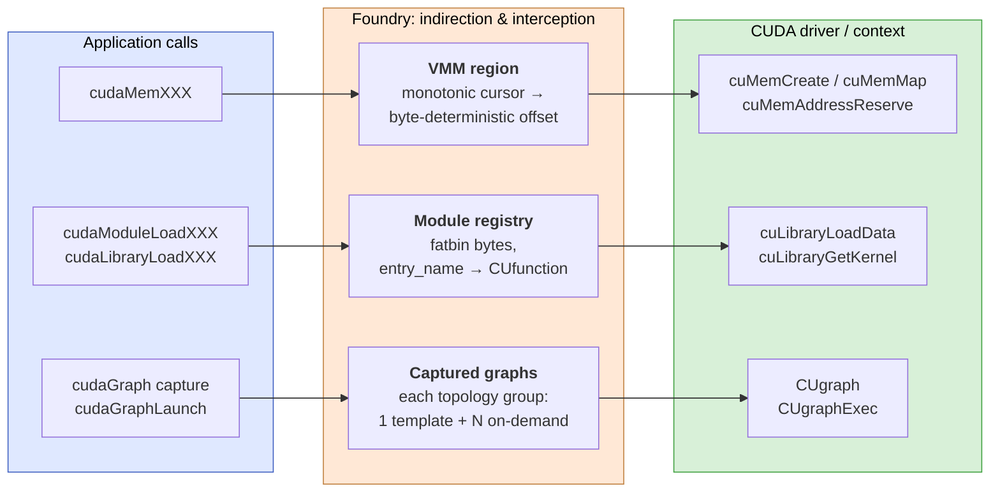

<div align="center">
  <h1>Foundry</h1>
  <p><em>Instantaneous CUDA graph restoration via execution context materialization.</em></p>

  <p>
    <a href="https://www.python.org/"></a>
    <a href="https://arxiv.org/abs/2604.06664"></a>
    <a href="LICENSE"></a>
  </p>
</div>

Foundry is a system that persists CUDA graph states through *template-based context materialization*. It materializes both the structure and execution context of captured CUDA graphs, making graph restoration kernel-agnostic and eliminating the need for hand-crafted patching rules. By intercepting CUDA driver calls, Foundry enforces a **deterministic memory layout** and automatically detects and serializes the **binaries of kernels** used in the CUDA graphs.

With Foundry, LLM serving engines can directly reload CUDA states from disk and skip the warmup process to start in a few seconds.

## Foundry in Action

Demonstration of serving `Qwen/Qwen3-30B-A3B-FP8` with expert parallel size = 2.

<div align="center">
  
  <p><strong>Baseline vLLM (top) vs. vLLM + Foundry (bottom)</strong>. Foundry reconstructs 256 graphs in <strong><u>1 sec</u></strong> (plus ~2 sec sampler warmup + API server init), while original vLLM spends around <strong><u>30 sec</u></strong> to warmup and capture graphs.</p>
</div>

## How it works

Foundry intercepts three classes of CUDA driver calls and routes each through its own piece of in-process state, so SAVE can serialize that state to disk and LOAD can rebuild an identical driver-side state from the archive.



- **Memory.** Every device allocation is funneled into a single VMM region `[base_addr, base_addr + region_size)`. A monotonic cursor gives every tensor a byte-deterministic offset; the underlying physical mapping is done with `cuMemCreate` + `cuMemMap`.
- **Modules / libraries.** As device code is loaded, the fatbin bytes and the `entry_name → CUfunction` table are recorded. A device-linked library passed to `cuLibraryLoadData` (NCCL's) is archived as passed and restored with the same call and options, never re-linked.
- **Captured graphs.** Each captured `CUgraph` is serialized and then grouped with other graphs that share the same topology (same kernels, dependency DAG and cluster dimensions; they differ only in kernel parameters). One graph per group is kept as the **template**; the rest are stored as **on-demand members** that carry only their per-node kernel parameters.

**SAVE** writes all three pieces to an archive. **LOAD** pre-maps the same VMM range, re-loads the same modules from the packed fatbins, builds each template's `CUgraph` node by node once, and then produces every member by rewriting the template's node parameters, either into a **dedicated** `CUgraphExec` per member (default, eager or lazy) or into one shared exec per template switched with `cuGraphExecUpdate`. Either way restored graphs replay at native speed; kernel handles embedded in the captured graphs resolve to the same device addresses they had at SAVE time. See [`docs/graph-templates.md`](docs/graph-templates.md) for the design and measurements.

## Inference-Engine Integrations

Foundry ships engine integrations under `foundry/python/foundry/integration/`. Per-engine setup instructions live under [`recipe/`](recipe/).

| Engine | Integration code | Documentation | Setup Instructions |
|---|---|---|---|
| SGLang | [`integration/sglang/`](python/foundry/integration/sglang/) | [`docs/sglang/overview.md`](docs/sglang/overview.md) | [`recipe/sglang/README.md`](recipe/sglang/README.md) |
| vLLM | [`integration/vllm/`](python/foundry/integration/vllm/) | [`docs/vllm/overview.md`](docs/vllm/overview.md) | [`recipe/vllm/README.md`](recipe/vllm/README.md) |
| TensorRT-LLM | [`integration/trtllm/`](python/foundry/integration/trtllm/) | [`docs/trtllm/overview.md`](docs/trtllm/overview.md) | [`recipe/trtllm/README.md`](recipe/trtllm/README.md) |

### Status

| Engine | Single GPU | DP | TP | EP |
|---|:---:|:---:|:---:|:---:|
| SGLang | ✅ | ✅ | ✅ | ✅ |
| vLLM | ✅ | ✅ | 🚧 | ✅ |
| TensorRT-LLM | 🚧 | 🚧 | 🚧 | 🚧 |

✅ validated end-to-end (SAVE → LOAD → query) &nbsp;·&nbsp; 🚧 not yet

SGLang TP uses torch symmetric-memory allreduce inside the decode graphs (TP=2/4);
SGLang EP covers DeepEP low-latency (NVSHMEM) and DeepEP v2 (NCCL symmetric
windows). Every SGLang configuration is validated with the full decode-graph set
(batch sizes 1..256) for restore time, per-token latency and greedy-output
equality against unmodified SGLang; see [`recipe/sglang/README.md`](recipe/sglang/README.md#validation).

The adapted SGLang fork is published at [`foundry-org/sglang`](https://github.com/foundry-org/sglang), branch `foundry-dep`: SGLang declares Foundry as an optional dependency (`sglang[foundry]`) and calls it through its in-tree adapter when `--cuda-graph-persistence` is set. See the [SGLang recipe](recipe/sglang/README.md) for the supported versions.

### Performance

SGLang on 8×H100 (2 GPUs per run), all 256 decode graphs captured or restored,
prefill graphs off on both sides, median TPOT of restored vs unmodified SGLang:

| Config | Model | Capture | Restore | Init to `/health`: SGLang → foundry LOAD | TPOT delta (bs 1 / 8 / 32 / 128) |
|---|---|---:|---:|---:|---|
| TP=2 (symm-mem) | Qwen3-32B | 26.7 s | 3.5 s | 63 s → 41 s | -0.4 / -0.3 / +0.0 / -0.7 % |
| EP=2 (DeepEP LL) | Qwen3-30B-A3B | 38.0 s | 2.5 s | 75 s → 45 s | -0.0 / -0.0 / +0.1 / +0.6 % |
| EP=2 (DeepEP v2, NCCL) | Qwen3-30B-A3B-FP8 | 56 s | 2.1 s | 93 s → 45 s | +0.0 / +0.0 / +0.2 / +0.2 % |

Restored graphs keep their programmatic-dependent-launch edges, so per-token
latency matches the captured graphs within run-to-run noise
([`docs/pdl-edge-batching.md`](docs/pdl-edge-batching.md)). Greedy completions
are identical to unmodified SGLang for dense TP and within SGLang's own
run-to-run nondeterminism for MoE.

## Roadmap

See [ROADMAP.md](ROADMAP.md) for the full development plan and progress.

## Requirements

- Linux x86_64, NVIDIA driver with CUDA 12.0+ (the driver's `libcuda.so.1` is loaded at runtime)
- PyTorch: `foundry.ops` is a torch C++ extension bound to the torch it was built
  with (major.minor and CUDA major), like sglang-kernel or flashinfer. Importing
  it under another torch raises a readable error.

## Installation

Prebuilt wheels are published as **`foundry-core`** (the import name is
`foundry`). A wheel works only with the torch major.minor and CUDA major it was
built for, so, like torch itself, the pairs live in separate package indexes
selected with `--extra-index-url` (`whl/<cuda>/torch<A.B>/`); PyPI carries the
pair SGLang pins:

| foundry-core | torch pair | index | CPython | Platform |
|---|---|---|---|---|
| 0.1.x (0.1.0rc2 on) | 2.14 (`torch==2.14.1`), cu130 | PyPI, `whl/cu130/torch2.14/` | 3.10-3.13 | manylinux_2_28 x86_64 |
| 0.1.x | 2.13 (`torch==2.13.0`), cu130 | `whl/cu130/torch2.13/` | 3.10-3.13 | manylinux_2_28 x86_64 |

```bash
pip install "torch==2.14.1" --index-url https://download.pytorch.org/whl/cu130
pip install "foundry-core>=0.1.0rc2,<0.2"
python -c "import foundry; print(foundry.__version__)"

# another pair: add its index (the wheel there carries a local version, +cu130.torch2.13)
pip install "torch==2.13.0" --index-url https://download.pytorch.org/whl/cu130
pip install "foundry-core>=0.1.0rc2,<0.2" --extra-index-url https://foundry-org.github.io/foundry/whl/cu130/torch2.13/
```

The wheel ships `foundry/ops.*.so` and `foundry/libcuda_hook.so` (the hook
SGLang/vLLM preload around their workers). No Boost or
other C++ runtime dependency is needed. Every wheel is also attached to the
[GitHub Release](https://github.com/foundry-org/foundry/releases).

### From source

Needed for any other torch, or for development. Requirements:

- CMake 4.0+ and ninja (`pip install "cmake>=4.0" ninja` if the system ones are older)
- the torch you will run with, already installed (Foundry compiles against it; rebuild after changing torch)
- CUDA Toolkit with `nvcc` (CUDA 12+; CUDA 13 with torch cu130)
- Boost headers, header-only (nothing is linked): the vendored copy in
  `third_party/boost` (populated by `tools/release/vendor_boost.sh`), or a
  system Boost >= 1.83 (Ubuntu 24.04: `apt-get install libboost-dev`; conda:
  `conda install -c conda-forge boost-cpp`; or point `FOUNDRY_BOOST_INCLUDE_DIR`
  at the directory that contains `boost/version.hpp`)

```bash
pip install "cmake>=4.0" ninja
# Torch 2.14 with CUDA 13.0
pip install torch==2.14.1 --index-url https://download.pytorch.org/whl/cu130
pip install -e . --no-build-isolation
```

`--no-build-isolation` matters: an isolated build compiles against whatever
torch pip resolves, not the one in your environment. From PyPI's sdist into
an existing environment: `pip install --no-build-isolation --no-binary foundry-core foundry-core`.

Release process (vendoring Boost, tagging, trusted publishing): [`docs/release.md`](docs/release.md).

### Debugging

Verbose C++ logging (allocator hook and graph replay) is gated behind a
single compile-time flag, `FOUNDRY_DEBUG`. Uncomment the
`// #define FOUNDRY_DEBUG` line at the top of `csrc/hook.cpp` or
`csrc/CUDAGraph.cpp` (or build with `-DFOUNDRY_DEBUG`) and reinstall.
With the flag on, every LOAD also logs a per-graph check that the restored
edge records (PDL programmatic edges) survived insertion; see
[`docs/pdl-edge-batching.md`](docs/pdl-edge-batching.md).

## Usage

Foundry is used through an inference engine, not by calling its Python API
directly. For SGLang, install `sglang[foundry]` and start the server with
`--cuda-graph-persistence save` once, then `--cuda-graph-persistence load`;
ready-to-run scripts per model and topology are in the
[SGLang recipe](recipe/sglang/README.md). For vLLM, see the
[vLLM recipe](recipe/vllm/README.md).

## Testing

Run the test suite:

```bash
pytest tests/
```

## Setting up clangd

```
conda install -c conda-forge libstdcxx-ng libgcc-ng
conda install -c conda-forge bear
bear -- python setup.py build_ext --inplace
```

## Contributors

- Xueshen Liu
- Yongji Wu
