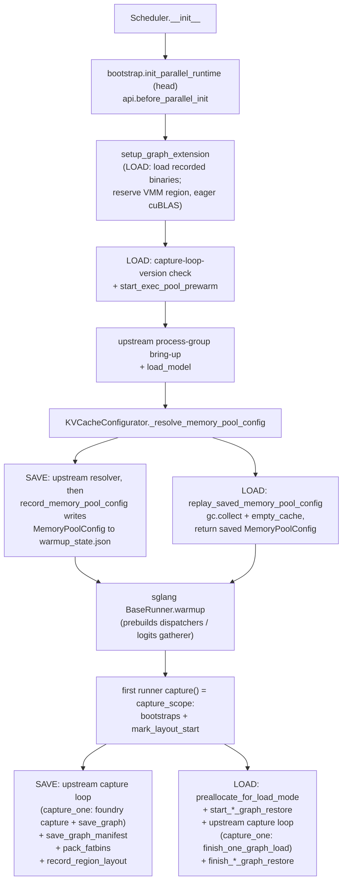

# SGLang Memory & Pool Lifecycle

## The invariant

**SAVE and LOAD must walk an identical VMM cursor trajectory** from `setup_graph_extension` through end-of-capture / end-of-load. Anything that allocates on one path but not the other shifts the cursor by some amount. The captured graph kernels reference VMM addresses fixed at SAVE time; if LOAD's allocations don't land at those exact offsets, the buffers the kernels read are unmapped or contain stale data — **silently**, with no foundry-side error.

## TOML config schema

```toml
base_addr          = 0x600000000000          # start of VMM region (default)
region_size        = "64GB"                  # total VMM reservation (default; the recipe uses 256GB)
workspace_root     = "foundry_archive"       # on-disk workspace (default)
graph_templates    = true                    # SAVE: group same-topology graphs under one template (default)

hook_library_path  = "…/libcuda_hook.so"     # optional; auto-discovered
nvshmem_host_path  = "…/libnvshmem_host.so"  # optional; auto-discovered from the nvidia-nvshmem wheel
verbs_udev_wait_shim_path = "…/libno_cdev_wait.so"  # optional; bare hosts only
```

Every key is optional; `mode` comes from `--cuda-graph-persistence` (a `mode` key in the TOML is ignored), and
`scratch_space_size` is ignored with an INFO line.

- `base_addr` must be high enough not to collide with model weights or PyTorch's default heap. `0x600000000000` is a safe pick on x86_64.
- `region_size` must exceed `final_alloc_offset` for the model + KV pool + graphs. 256 GiB is generous for a 14 B model.
- `workspace_root` is shared across ranks; per-rank artifacts go in `workspace_root/rank_{N}/`. Delete `workspace_root` before any SAVE.

## Lifecycle



## Allocation buckets

### Bucket B — deterministic runtime state

Model weights, KV pools, attention workspace buffers, FlashInfer wrapper `_int_workspace_buffer`s, captured-graph alloc events. These must allocate in identical order on SAVE and LOAD. Their final cursor position is the `final_alloc_offset` persisted to `warmup_state.json`.

### Bucket C — forbidden divergence

Anything that runs on one path but not the other. The fixes we landed identify and align these known cases:

1. The two pre-capture warmup forwards in `capture_one_batch_size` — skipped on SAVE so they don't pollute the caching allocator with freed activations LOAD can't reproduce. (See doc 06.)
2. The per-bs attention metadata init (`init_forward_metadata_out_graph(in_capture=True)`: FlashInfer wrappers, `_int_workspace_buffer`) outside the captured graph. Originally aligned with a pre-pass on both sides plus a SAVE-only reuse shim; now both modes run the upstream capture loop and substitute only `capture_one`, so the init runs at the same point and in the same order on SAVE and LOAD, with each graph's allocator events replayed where SAVE captured it. (See [`memory-consistency.md`](memory-consistency.md) Bug 3.)
3. `_resolve_memory_pool_config` calls `get_available_gpu_memory(empty_cache=True)` on SAVE; LOAD's `replay_saved_memory_pool_config` mirrors it with `gc.collect()` + `torch.cuda.empty_cache()` before returning the saved config. (See below.)

## The `_resolve_memory_pool_config` mirror

`init_memory_pool` on SAVE calls `_resolve_memory_pool_config` → `_profile_available_bytes` → `get_available_gpu_memory(...)` which calls `torch.cuda.empty_cache()` (`sglang/srt/utils/common.py`). `empty_cache` releases torch caching-allocator segments back to the driver via `cuMemFree_v2`, which the foundry hook unmaps.

LOAD returns the saved config from the head of the resolver without profiling, so without a mirror it has no equivalent drain: caching-allocator segments retained on LOAD change which torch.empty calls hit cache vs. miss during the subsequent attention-backend init (a 20 MB cursor drift by the time `capture()` was reached).

`replay_saved_memory_pool_config` therefore runs the same drain before it returns:

```python
gc.collect()
torch.cuda.empty_cache()  # mirror SAVE's _resolve_memory_pool_config side effect
```

## Why saving raw memory numbers isn't enough

The pool config is computed from a profile and a configurator (`_resolve_memory_pool_config`: free-memory profile, pool sizes, token constraints, request slots).

Persisting the resolved `MemoryPoolConfig` (via `dataclasses.asdict`) and returning it on LOAD is necessary and sufficient. Persisting raw free-memory numbers would re-run the configurator on LOAD with stale inputs. Context overrides the resolver issued (e.g. the Mamba/GDN state-pool size) are saved with it and replayed.

`WarmupState.memory_pool_config` is exactly this dict; `WarmupState.context_overrides` holds the overrides.

## VMM region setup

`setup_graph_extension` (in `runtime.py`):

- Computes the per-rank workspace path (`{workspace_root}/rank_{compute_workspace_rank(...)}`)
- On SAVE: removes the rank workspace if it exists, then creates it fresh
- On LOAD (before the region is reserved):
    - `cge.set_skip_fatbin_processing(True)`
    - `cge.load_cuda_modules_and_libraries(workspace_dir)` — the binary restore: restores the fatbins SAVE wrote, into device code memory
- `cge.set_allocation_region(cfg.base_addr, parse_size(cfg.region_size))` — reserves a VMM address range; the cursor starts at `base_addr`
- `torch._C._cuda_getCurrentBlasHandle()` — eager cuBLAS handle
- creates the `CUDAGraphExtensionState` singleton

## Region layout

Two SAVE-side calls describe the deterministic range for LOAD:

- `mark_layout_start` runs on both modes at the sequence point where LOAD preallocates (at the first capture scope, after the pre-capture bootstraps: FlashInfer tactics, NCCL communicators, the check of sglang's prebuilt state, and SAVE's DeepGEMM init). It runs `gc.collect()` and returns torch's cached-but-free blocks to the driver on both sides, then re-enables the cyclic GC that was held since the head of the parallel bring-up, so the caching allocator is in the same state when the layout begins, and on SAVE records the cursor as `start_offset`. LOAD's cursor equals `start_offset` by construction (no eager forward runs on either mode); a difference is logged as a warning.
- `reserve_rng_blocks` runs right after it (LOAD: after `preallocate_for_load_mode`). Every graph capture keeps its RNG capture state, two one-element tensors, in the default pool's small blocks; SAVE allocates them inside the capture's hook record, LOAD in `finish_one_graph_load` with the region suspended. If they grew a new small segment, it would exist on SAVE only, and later small allocations a graph bakes in (e.g. FA3's decode metadata) would move on LOAD with every offset check passing. Both modes therefore grow the small pool by the same number of blocks here (SAVE: `FOUNDRY_RNG_RESERVE_BLOCKS`, default 16384; LOAD: the number SAVE recorded, 0 for older archives), and SAVE refuses a capture that still grows it (`no_small_pool_growth`).
- `record_region_layout` runs after each decode-type capture loop completes (after `save_graph_manifest` and `pack_fatbins`; the last scope's write is the one LOAD reads). It writes `rank_{N}/region_layout.json` with `start_offset`, the `final_alloc_offset` watermark, `rng_reserve_blocks` and `live_ranges` — the `(offset, size)` ranges still mapped at that point (`cge.get_live_region_ranges`). `final_alloc_offset` is also mirrored into the shared `warmup_state.json`.

`preallocate_for_load_mode` reads the layout. It calls `cge.preallocate_ranges(live_ranges, final_alloc_offset)` from LOAD's current cursor, which maps only the live ranges — one physical handle per coalesced segment — so memory SAVE allocated and freed inside the span costs LOAD nothing, then checks the cursor against `start_offset` (equal by construction; a difference is logged, and the cursor is moved up when LOAD is behind). The cursor is **not** advanced by the preallocation itself; allocations that land in the span are pointer bumps (no driver calls). An allocation that lands in an unbacked hole of the span (a range SAVE allocated and released again before the end, which LOAD's replay of the same sequence allocates too) is backed on demand by the hook and logged at INFO (`mapped N MB on demand`); the same ranges appear on every LOAD of an archive.
